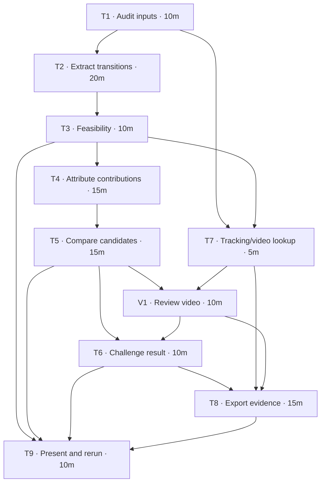

# Defence to Danger Implementation Plan

> **For agentic workers:** REQUIRED SUB-SKILL: Use superpowers:subagent-driven-development or superpowers:executing-plans to implement this plan task-by-task. Steps use checkbox syntax for tracking. Execution is a separate step from creating this plan.

**Goal:** Identify and explain the player with the strongest contribution to turning recorded defensive interventions into attacks, using a transparent comparison and selected match moments.

**Architecture:** One notebook extracts bounded transition passages from events, attributes distinct contributions, and compares players. Tracking supplies explanatory snapshots; source video checks the proposed mechanism before final selection. A feasibility check determines whether the headline can reasonably emphasise danger or should emphasise progression.

**Tech Stack:** Python 3.12, pandas, NumPy, Matplotlib, pyarrow, and the existing uv environment; installed FFmpeg/ffprobe for optional local video assets. No new permanent Python dependencies or test framework.

**Spec:** [Research draft](../../../mvp_analysis_draft.md).

## Global constraints

- Consider both teams and every position; this is a contribution within one phase of play, not a proven overall MVP.
- Default transition window: 15 seconds. Check alternatives of 10 and 20 seconds.
- Initial starts: sequence-opening tackles/interceptions; expected baseline is 138 of 177 defensive events.
- Stop on a sequence/half boundary, opponent event, failed pass, restart, or further tackle/interception. Do not reconnect after a stop.
- Final-third entry: completed pass from x_att <= 17.5 m to x_att > 17.5 m. Normalise coordinates using attack_dir.
- Use receiver_x/receiver_y for pass endpoints. Missing endpoints mean unmeasurable, not zero progression.
- Keep shots, goals, and territorial progress separate. Never add a scoring shot and its goal as two chances.
- Keep recoverer, outlet, advancer, and finisher contributions separate. No arbitrary composite MVP score.
- Use nearest-frame tracking matches within the same half; report timestamp gaps and missing ball coordinates. Label video time explicitly.
- Full-match video seconds = timestamp_ms / 1000. Verify an identifiable moment in each half against the actual MP4 before export.
- Review video before finalising the player claim. Inadequate visibility means unverified, not confirmed. Keep source files unchanged.
- Preserve anonymised IDs and all source datasets; respect restricted dataset usage.
- Restart the notebook kernel and run every cell in order after edits.

## Files and outputs

| File | Responsibility |
|---|---|
| `mvp_analysis_draft.md` | Existing research specification; read as context |
| `defence_to_danger.ipynb` | New analysis, checks, tables, figures, and final presentation |
| `clips/clip_manifest.csv` | Generated local clip times, evidence notes, and output paths |
| `clips/transition_<id>.mp4` | Generated short evidence video with context |
| `clips/transition_<id>.gif` | Optional generated presentation preview |
| This plan | Task tracking and dependency definitions |

Intermediate analytical tables remain in the notebook; selected media and the clip manifest are generated local assets. Do not modify the introductory notebooks, source video, datasets, or dependency files. No standalone package or dashboard is needed.

## Dependency graph and budget

| ID | Task | Depends on | Budget | Independently checkable output |
|---|---|---|---:|---|
| T1 | Audit inputs and establish baselines | — | 10 min | Input/coverage audit |
| T2 | Extract bounded transitions | T1 | 20 min | Transition and event-membership tables |
| T3 | Check feasibility and settle the headline | T2 | 10 min | Outcome counts, audited examples, scope decision |
| T4 | Attribute contributions and outcomes | T3 | 15 min | Transition metrics and player-contribution table |
| T5 | Compare players and choose provisional cases | T4 | 15 min | Three-candidate comparison |
| T7 | Prepare tracking and video lookup | T1, T3 | 5 min | Frame lookup and video readiness |
| V1 | Review candidate passages in video | T5, T7 | 10 min | Checked observations and candidate corrections |
| T6 | Challenge the result | T5, V1 | 10 min | Window sensitivity and confidence assessment |
| T8 | Export and explain selected moments | T6, T7, V1 | 15 min | Short MP4s, optional GIFs, manifest, and pitch figures |
| T9 | Assemble the answer and rerun | T3, T5, T6, T8 | 10 min | Executed notebook and concise conclusion |

Total effort: **120 minutes**. For one person, use T1 → T2 → T3 → T4 → T5 → T7 → V1 → T6 → T8 → T9. With separate workers, T7 can proceed alongside T4–T5 after T3; pass back the lookup and checks rather than editing the same notebook concurrently.

The dependency critical path is T1 → T2 → T3 → T4 → T5 → V1 → T6 → T8 → T9: **115 minutes** under these estimates. A single worker still needs the additional five minutes for T7. Estimates exclude installation, video-download, and long encoding delays and assume the locked environment is ready.

## Review focus

1. Restarts and failed passes inside one sequence must terminate the passage: pin with T2 synthetic examples.
2. Missing pass endpoints must remain unknown, while real zero-metre passes remain measurable: check in T4.
3. A scoring shot plus goal must not inflate outcomes: verify separate indicators in T4.
4. One player filling several roles or participating several times must not inflate passage counts: deduplicate in T4 and check denominators in T5.
5. Sparse outcomes, short appearances, missing tracking, video-clock mismatch, and unclear player visibility must not produce unsupported certainty: inspect in T3, T5, V1, and T7–T9.

## Task details

### T1 — Audit inputs and establish baselines

**Files:** Create `defence_to_danger.ipynb`, opening Markdown and input-audit cells.

**Consumes:** `DATA_DICTIONARY.md`, `events.csv`, `player_summary.csv`.

**Produces:** DataFrames `events`, `summary`, and a displayed `input_audit` table. Preserve raw columns; sort event processing by timestamp_ms and event_id.

- [ ] Read the dictionary and load events and summary from repository-relative paths.
- [ ] Assert 1,289 events, 33 summary rows, six goal events, and four shots flagged as goals. Parse missing booleans without converting missing values into True.
- [ ] Confirm unique event IDs and summary player IDs, valid team/direction values, and the 177/138 intervention counts. Explain discrepancies before proceeding.
- [ ] Display receiver-ID/coordinate coverage for completed passes and minutes-played coverage. Known reference: 523 of 536 completed passes have receiver coordinates and ID.

**Done when:** Assertions pass and relevant missing fields are visible. Existing environment setup, if needed: `uv sync --locked` from the repository root.

### T2 — Extract bounded transitions

**Files:** Extraction and validation cells in the notebook.

**Interface:** `extract_transitions(events: pd.DataFrame, window_s: float = 15.0) -> tuple[pd.DataFrame, pd.DataFrame]`.

**Produces:** `transitions`, one row per candidate start, and `transition_events`, event memberships keyed by transition_id. IDs must stay stable across window choices; use the opening event_id. Include starting player/team/half/time/location, end time, stop reason, and terminal event ID.

- [ ] Before implementing extraction, create small synthetic event examples covering: same-sequence restart, failed pass, opponent/sequence switch, half boundary, second intervention, exact 15-second inclusion, and an event just beyond the window.
- [ ] Implement the interface and run assertions against those examples. Preserve terminal events as audit metadata; failed passes/restarts are not productive actions in the retained passage.
- [ ] Extract all candidate starts, including starts with no productive follow-up. Keep those unresolved cases in denominators.
- [ ] Assert 138 candidate rows, no retained event beyond its boundary, and no event shared by separate candidate passages under the initial restriction.

**Done when:** Boundary examples pass and the two tables let someone trace any retained event to its start and stop.

### T3 — Feasibility and scope decision

**Files:** Pilot-review cells and a short methodology decision in the notebook.

**Consumes:** T2 tables and source event rows.

**Produces:** `feasibility_summary`, audited example IDs, and a Markdown statement of the selected headline and sample restriction.

- [ ] Count candidate passages with completed passes, shots, and goal events; keep those categories separate.
- [ ] Audit approximately five varied passages: productive, unresolved, and terminated examples. Inspect timestamps and stopping events, not only sequence IDs.
- [ ] Inspect a few of the 39 excluded defensive events and state what the sequence-start restriction misses. Keep the restricted sample for this sprint unless there is a clear, consistent reason to revise extraction; then rerun T2 checks.
- [ ] Use a planning rule: fewer than five shot-ending passages triggers the progression-focused headline, “Who turned defence into attack?” This is a practical presentation threshold, not statistical significance. Retain shots as case studies.
- [ ] If reliable attacking follow-up is too sparse even for progression, report that limitation and the best-supported cases; do not manufacture a player ranking.

**Done when:** The question matches the available evidence before player selection begins.

### T4 — Attribute outcomes and contributions

**Files:** Metric, attribution, and check cells in the notebook.

**Interface:** `attribute_transitions(transitions: pd.DataFrame, transition_events: pd.DataFrame) -> tuple[pd.DataFrame, pd.DataFrame]`.

**Produces:** `transition_metrics` and long-form `contributions`. Contribution keys: transition_id, player_id, contribution_role. Store first supporting event_id and any progression measure separately.

- [ ] Normalise event starts and receiver endpoints using attack_dir. Measure forward gain only for completed passes with usable coordinates.
- [ ] Add separate indicators for observed attacking follow-up, shots, goals, final-third entry, endpoint coverage, and failed-pass termination. Keep shot/goal counts separate and never sum them as a chance total.
- [ ] Assign recoverer, first outlet, entry passers/receivers, and finishers. If there is no entry, identify the passer with the greatest positive measurable forward gain; use earliest event_id for a tie, and assign no advancer if all gains are non-positive or unknown.
- [ ] Keep missing receiver IDs unattributed. Deduplicate contribution keys and mark whether an advancer contributed a final-third entry or the fallback progression pass.
- [ ] Check examples for missing endpoint versus true zero gain, equivalent passes in opposite attack directions, exact final-third boundary, and one player holding multiple roles. Verify a scoring shot/goal pair does not become two chances.

**Done when:** Every attributed contribution links to source evidence and missing data is distinguishable from zero contribution.

### T5 — Compare players

**Files:** Player-summary tables and candidate discussion in the notebook.

**Consumes:** T4 outputs and `summary`.

**Produces:** `player_comparison` in long form: player_id, role, metric, numerator, denominator, value, minutes_played; plus up to three candidate IDs and supporting passage IDs.

- [ ] Show total candidate starts and distinct passage participation for each role, alongside attacking outcomes, progression, unresolved cases, and failures.
- [ ] Use starts as recoverer denominators and observed outlet/advancer opportunities for those respective roles. Show numerator and denominator together; do not compare unlike rates as equivalent measures.
- [ ] Add start territory and minutes played. Use totals as primary evidence and flag small samples; any per-90 values are supporting context.
- [ ] Check that repeated events and multiple roles do not inflate distinct passage counts or success shares above their denominators.
- [ ] Select candidates from both teams based on evidence, without forcing team/position balance. Write the strongest case and strongest counterargument for each; permit no clear winner.

**Done when:** The shortlist is traceable to separate measures rather than a hidden weighted score.

### T6 — Challenge the result

**Files:** Sensitivity table and confidence discussion in the notebook.

**Consumes:** T2/T4 functions, the T5 comparison, and V1 video observations. Execute after V1 even though task IDs retain their original numbering.

**Produces:** Window-by-candidate outcome table and final candidate IDs for T8.

- [ ] Reuse extraction and attribution at 10, 15, and 20 seconds; preserve starting IDs and stopping rules.
- [ ] Compare candidate involvement, shots, territorial entries, and exposure to starting territory. Explain material changes rather than choosing the window that favours a player.
- [ ] Check whether the claim relies on one passage, very few opportunities, short playing time, or unequal missing-data coverage.
- [ ] State confidence and the strongest alternative explanation. Revise the leading case or retain multiple candidates when warranted.
- [ ] Incorporate V1 observations. Correct derived attribution when the video contradicts it, preserving raw event rows and documenting the correction; rerun affected comparisons. Otherwise keep uncertain identities/actions unverified.

**Done when:** The final narrative reflects instability and sample limitations.

### T7 — Prepare tracking and video lookup

**Files:** Tracking-loading and frame-lookup cells in the notebook.

**Interface:** `nearest_frame(players: pd.DataFrame, timestamp_ms: int, half: int) -> tuple[pd.DataFrame, int]`, returning frame rows and absolute time gap in milliseconds.

**Consumes:** `players.parquet`, T1 clock conventions, T3 selected scope.

**Produces:** `players`, tested nearest-frame lookup, and `video_source` metadata for V1/T8. This branch can be prepared independently of player comparisons.

- [ ] Load tracking, separate referee rows, and prepare sorted unique frame times per half.
- [ ] Implement nearest-frame lookup; choose the earlier frame on an exact tie. Never silently substitute a different half or an empty selection.
- [ ] Check exact-frame, between-frame, tie, and unavailable-half cases. Return clear failure information for unavailable data.
- [ ] Report missing ball coordinates and frame-time gaps for selected sample events. Plot event coordinates when needed and label their source; do not invent ball positions.
- [ ] Locate the supplied MP4 without moving it. Record its path, duration, frame rate, and dimensions using ffprobe. FFmpeg/ffprobe are installed; no MP4 was present at the repository root during planning. Source availability remains pending until the user supplies a location or the file appears.
- [ ] Set video readiness explicitly. Missing video leaves event analysis runnable; V1 records visual validation as pending and T8 falls back to pitch figures. Do not mark video work complete without a readable source.

**Done when:** Tracking lookup is checked and video availability/metadata are explicit. Video work requires the source file; event analysis does not.

### V1 — Review candidate passages in video

**Files:** Video-review cells in the notebook; evidence rows that will become `clips/clip_manifest.csv`.

**Consumes:** T5 provisional candidates/passages and T7 video source. This task precedes T6 and final export.

**Produces:** `video_review`, keyed by transition_id, with source filename, start_s, end_s, focus_player, proposed_claim, observed_action, verification_status, and relevant event IDs.

- [ ] Verify the source clock using an identifiable event in each half. Use timestamp_ms / 1000 directly for the supplied full recording. If the actual file is trimmed or different, establish and document its mapping before exporting; never silently apply a guessed offset.
- [ ] Review two supportive passages and, if time permits, a rival, failed, or ambiguous passage. Confirm the opening intervention, outlet, forward action, opponents' response, and player identity where visible.
- [ ] Start approximately three seconds before the opening intervention and end three seconds after the observed outcome or stopping event, clamped to file boundaries. Context outside the measured window does not alter analysis membership.
- [ ] Record observations that support, contradict, or leave the proposed claim uncertain. A video example illustrates the mechanism; repeated event evidence supports the broader comparison.
- [ ] If video is unavailable, record validation as pending and proceed with the event/tracking fallback. If visibility is poor, retain uncertainty rather than describing the action as proven.

**Done when:** Every selected passage has a documented observation or an explicit reason visual confirmation is pending.

### T8 — Export and explain selected moments

**Files:** Plotting/export cells and captions in the notebook; generated assets under `clips/`.

**Consumes:** Final T6 candidates, attributed passages, T7 lookup, and V1 review/times.

**Produces:** Two selected evidence sequences, an optional third, one or two supporting pitch figures, short MP4s and optional GIFs when video is available, and a clip manifest. Prioritise readable evidence over export polish.

- [ ] Select reviewed V1 passages consistent with the final T6 comparison, including a rival, unsuccessful, or ambiguous passage where possible.
- [ ] Plot pitch coordinates in metres, player/team labels, pass sequence, and relevant snapshots. Distinguish positions at the snapshot time from events occurring later.
- [ ] Label video timestamps, attacking direction, event/transition IDs, and frame gaps. Handle missing tracking with a clearly labelled event-only diagram when possible.
- [ ] Describe observed options, opponents, and actions. Avoid treating proximity as proven pressure or claiming an unobserved counterfactual.
- [ ] Extract short MP4s using FFmpeg, re-encoding for accurate boundaries. Preserve originals. Call FFmpeg through an argument list if invoked from Python; check the process return code.
- [ ] Optionally convert those clips to looping GIFs using palette generation and palette use, initially 10 fps and 854 pixels wide with preserved aspect ratio. Keep real-time playback and the complete action visible; source frames can be decoded directly without saving individual images.
- [ ] Save the V1 evidence notes plus MP4/GIF relative paths to `clips/clip_manifest.csv`. Use transition IDs in filenames, link media from the notebook, and keep extracts within the dataset's permitted usage.
- [ ] Play each final asset, check boundaries/player visibility/readability, and compare its duration with the manifest. A GIF is a presentation preview; keep the MP4 for clearer inspection. Skip GIFs if encoding or readability threatens the time budget.

**Done when:** Every caption is linked to source events and checked media or clearly labelled event/tracking evidence. Exported assets play and match the manifest.

### T9 — Assemble and verify the answer

**Files:** Opening question, final Markdown, and outputs in `defence_to_danger.ipynb`.

**Consumes:** T3 scope decision, T5 comparison, T6 confidence, T8 figures.

**Produces:** A reproducible notebook and a short presentation within it.

- [ ] Present the question, sample definition, leading player/candidates, supporting comparison, illustrative moments, strongest rival explanation, and limitations.
- [ ] Use the headline chosen from evidence. Limit the claim to defensive transitions; do not quietly promote it to proven overall MVP.
- [ ] Restart the project kernel and run every cell in order. In the existing uv setup, launch with `uv run --with notebook jupyter notebook defence_to_danger.ipynb`; select the project environment and use Restart Kernel and Run All Cells.
- [ ] Confirm baseline and synthetic assertions pass, figures render, tables support prose, and uncertainty/missing cases remain visible. Inspect changes for unrelated notebook-output churn.
- [ ] Confirm available media links work and export cells reuse existing checked assets on rerun rather than repeatedly encoding them. Missing local video/outputs must show an explanatory fallback instead of breaking the analytical cells.

**Done when:** The conclusion can be challenged and reproduced from the notebook without relying on conversation history.

## Time-pressure rules

- Keep the extraction and evidence checks; reduce presentation polish first.
- Use two evidence sequences and one supporting figure when media work takes longer than expected; skip GIFs before reducing evidence checks.
- Keep the initial sample restriction unless changing it is necessary for correctness.
- Prefer a supported progression finding or an inconclusive answer over a forced danger/MVP claim.
- No dashboard, bespoke animation system, new model training, or permanent dependency additions. Simple FFmpeg GIF previews are in scope.

## Plan self-review

- Spec coverage: definitions and feasibility map to T1–T3; attribution to T4; comparison to T5; video review to V1; sensitivity to T6; tracking/source readiness to T7; media/figures to T8; execution validation and presentation to T9.
- Interfaces: all intermediate tables and extraction/attribution/frame-lookup functions are defined at their producing task.
- Checks: boundary handling, missing endpoints, scoring duplication, role duplication, sparse outcomes, and tracking failures have task-owned checks.
- Dependency audit: every prerequisite is defined; the graph is acyclic; budgets total 120 minutes and include the V1 video-review task.
- This plan creates a research notebook, not a reusable software package. Assertions and manual audits replace an unnecessary test-framework setup.
